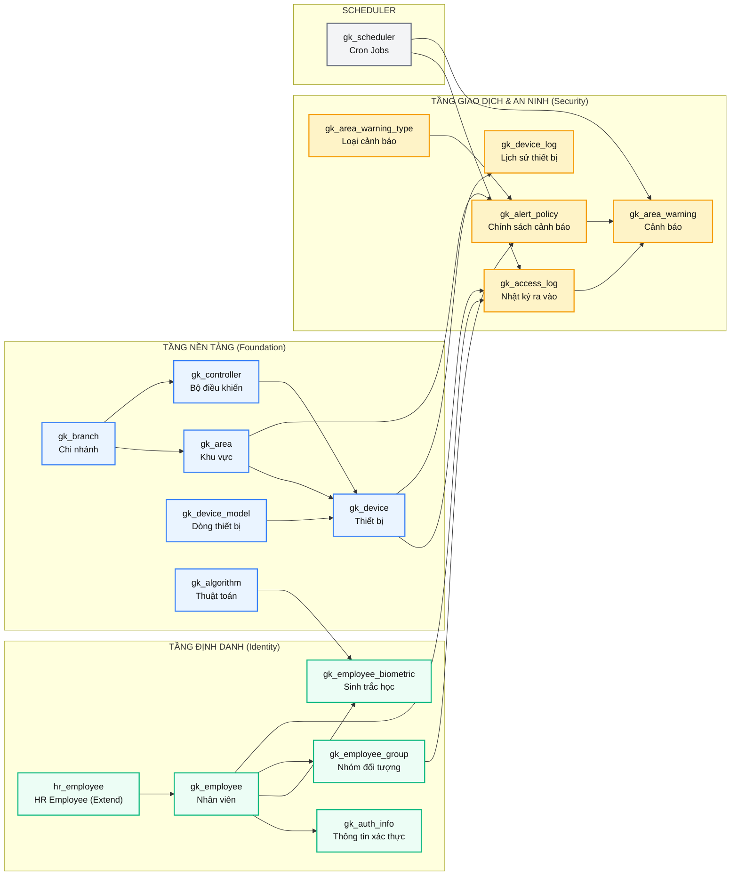
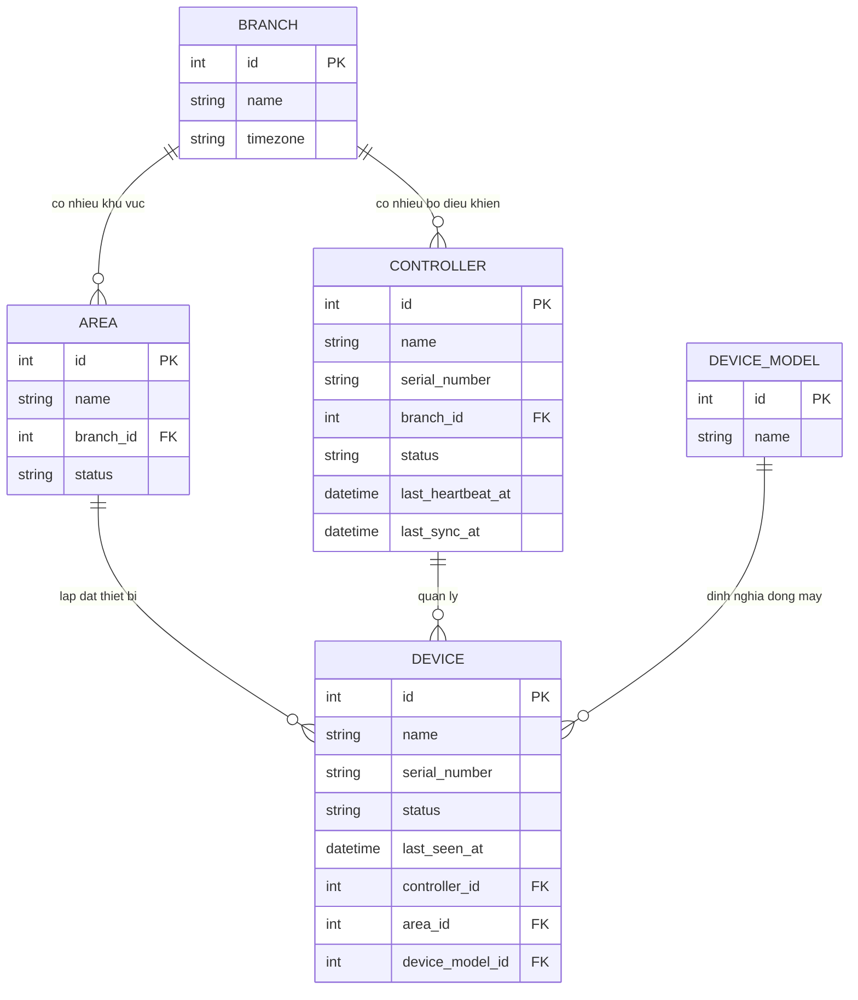
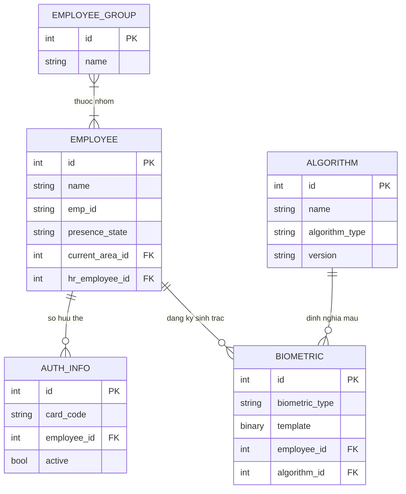
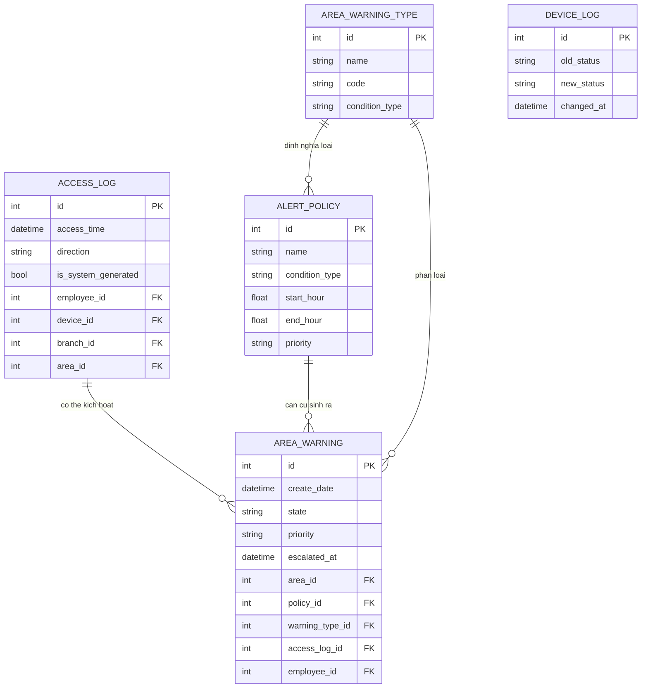
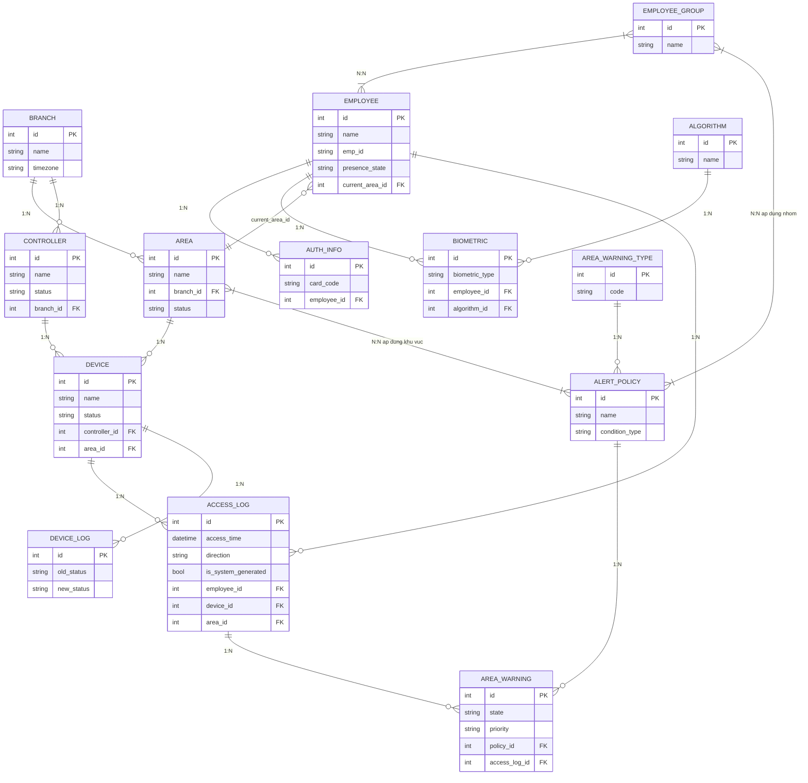
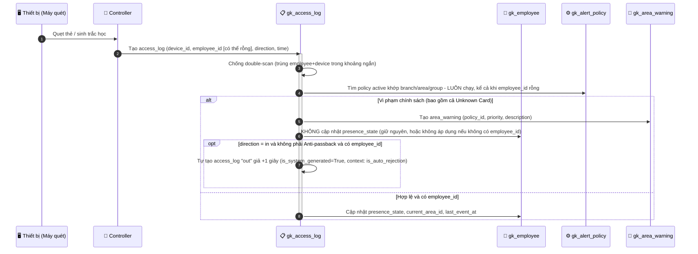

# TÀI LIỆU KỸ THUẬT TỔNG THỂ

# DỰ ÁN: T4 GATEKEEPER - HỆ THỐNG QUẢN LÝ AN NINH VÀ KIỂM SOÁT RA VÀO

**Phiên bản:** 1.1 | **Nền tảng:** Odoo 18.0 | **Ngày biên soạn:** 2026-07-06 | **Đối tượng đọc:** Development Team, BA, QA

## MỤC LỤC

1. [Giới thiệu Dự án](#1-giới-thiệu-dự-án)
   - 1.1 Tóm tắt (Executive Summary)
   - 1.2 Phạm vi Dữ liệu Lưu trữ
   - 1.3 Các Hành động & Nghiệp vụ Cụ thể
   - 1.4 Đối tượng sử dụng hệ thống
2. [Kiến trúc Tổng quan](#2-kiến-trúc-tổng-quan)
3. [Kịch bản Vận hành Thực tế](#3-kịch-bản-vận-hành-thực-tế)
4. [Kiến trúc Module & Sơ đồ Phụ thuộc](#4-kiến-trúc-module-sơ-đồ-phụ-thuộc)
5. [Cấu trúc Thư mục & Chức năng Từng File Mã nguồn](#6-cấu-trúc-thư-mục-chức-năng-từng-file-mã-nguồn)
6. [Sơ đồ Thực thể Dữ liệu (ERD)](#7-sơ-đồ-thực-thể-dữ-liệu-erd)
7. [Đặc tả Chi tiết Từng Bảng Dữ liệu](#8-đặc-tả-chi-tiết-từng-bảng-dữ-liệu)
8. [Luồng Xử lý Cốt lõi & Mã nguồn](#9-luồng-xử-lý-cốt-lõi-mã-nguồn)
9. [Phân quyền Hệ thống (Security)](#10-phân-quyền-hệ-thống-security)
10. [Vấn đề Tồn đọng & Kế hoạch Triển khai](#11-vấn-đề-tồn-đọng-kế-hoạch-triển-khai)

## 1. GIỚI THIỆU DỰ ÁN

### 1.1. Tóm tắt (Executive Summary)

**T4 Gatekeeper** là một hệ thống **Kiểm soát Ra vào và Quản trị An ninh (Access Control & Security Management System)** chạy trên nền tảng ERP mã nguồn mở **Odoo 18.0**, tích hợp trực tiếp với module **HR** và **T4 CoreAPI**.

Hệ thống đóng vai trò **trung tâm dữ liệu an ninh (Security Data Hub)**, tiếp nhận tín hiệu từ thiết bị phần cứng (đầu đọc thẻ RFID, máy nhận diện khuôn mặt, máy quét vân tay) thông qua Controller trung gian, nhằm:

- **Định danh** nhân viên qua thẻ vật lý hoặc dữ liệu sinh trắc học.
- **Giám sát hiện diện** - biết mỗi nhân viên đang ở trong hay ngoài khu vực nào.
- **Phát hiện & cảnh báo tự động** các vi phạm an ninh, không cần con người theo dõi thủ công.
- **Đồng bộ hai chiều với HR** - mọi thay đổi hồ sơ nhân viên tự động phản ánh sang Gatekeeper.
  > [!NOTE]
  > Khác với một số hệ thống Gatekeeper tham khảo dùng mô hình `Location` cây phân cấp + `Gate` độc lập, dự án này dùng mô hình đơn giản hơn: **`Branch → Area → Device/Controller`**, phù hợp quy mô công ty (không phải KTX hàng nghìn người).

### 1.2. Phạm vi Dữ liệu Lưu trữ (Hệ thống lưu trữ những gì?)

1. **Dữ liệu Định danh & Nhân thân (Identity Data):**
   - Hồ sơ nhân viên (`t4.gate_keeper.employee`): Tên, avatar, mã nhân viên (`emp_id` - UUID tự sinh, bất biến), liên kết `hr.employee`.
   - Thẻ định danh vật lý (`t4.gate_keeper.auth_info`): Mã thẻ RFID (`card_code`), trạng thái kích hoạt.
   - Nhóm đối tượng (`t4.gate_keeper.employee_group`): Phân loại nhân viên phục vụ cấu hình chính sách cảnh báo.
2. **Dữ liệu Sinh trắc học (Biometric Data):**
   - Thuật toán sinh trắc (`t4.gate_keeper.algorithm`): Loại + phiên bản thuật toán mã hóa.
   - Mẫu sinh trắc học (`t4.gate_keeper.employee.biometric`): Kiểu sinh trắc (vân tay/khuôn mặt) và chuỗi nhị phân template.
3. **Dữ liệu Không gian & Thiết bị (Spatial & Hardware Data):**
   - Chi nhánh (`t4.gate_keeper.branch`): Timezone, địa chỉ, công ty sở hữu.
   - Khu vực (`t4.gate_keeper.area`): Không gian con trong chi nhánh (kho, văn phòng...).
   - Bộ điều khiển (`t4.gate_keeper.controller`) & Thiết bị (`t4.gate_keeper.device`): IP, Serial Number, firmware, tình trạng kết nối.
4. **Dữ liệu Giao dịch & An ninh (Transactions & Security):**
   - Nhật ký ra vào (`t4.gate_keeper.access_log`): Ghi nhận quẹt thẻ/sinh trắc chính thức - **cần tính bất biến** phục vụ hậu kiểm.
   - Chính sách cảnh báo (`t4.gate_keeper.alert_policy`): Định nghĩa giờ cấm, khu vực cấm, nhóm áp dụng.
   - Cảnh báo vi phạm (`t4.gate_keeper.area_warning`): Ghi nhận vi phạm để bảo vệ xử lý.
   - Lịch sử thiết bị (`t4.gate_keeper.device_log`): Audit trail uptime/downtime.

### 1.3. Các Hành động & Nghiệp vụ Cụ thể (Hệ thống làm được gì?)

1. **Quản trị Thiết bị & Giám sát Trạng thái:**
   - **Heartbeat:** Controller định kỳ gọi API `ControllerHeartbeat` để cập nhật `last_heartbeat_at`.
   - **Tự động quét ngoại tuyến:** Cronjob `cron_update_hardware_status` phát hiện controller/device quá 5 phút không phản hồi → chuyển `offline`, cascade cập nhật thiết bị con.
   - **Ghi log lịch sử thiết bị** _(cần bổ sung)_: Ghi lại mỗi lần chuyển trạng thái để tra cứu sau này.
2. **Đồng bộ Nhân viên (HR Sync):**
   - Tạo/sửa `hr.employee` → tự động tạo/cập nhật `t4.gate_keeper.employee` tương ứng.
   - Controller gọi `ControllerEmployeeSync` (kiểu **pull**) để lấy danh sách nhân viên cần đồng bộ theo `write_date`.
   - Cronjob `cron_sync_missing_employees` quét vét các trường hợp đồng bộ realtime bị lỗi.
3. **Kiểm soát & Giám sát Hiện diện (Presence Tracking):** _(cần bổ sung)_
   - Cập nhật `presence_state` (`inside`/`outside`) và `current_area_id` sau mỗi lượt quẹt hợp lệ.
   - Tự động từ chối cập nhật hiện diện + sinh sự kiện "ra" giả khi vi phạm giờ cấm, tránh khóa sai trạng thái.
4. **Động cơ Phân tích & Xử lý Cảnh báo (Alert Engine):**
   - **Hiện có:** kiểm tra ngoài giờ làm việc hard-code (8h–17h, có xét cuối tuần) → tạo `area_warning`. Kiểm tra thiết bị offline hard-code trong `gk_device.py`.
   - **Cần bổ sung:** cấu hình chính sách qua UI (`alert_policy`), Anti-passback, thẻ lạ, khu vực cấm, ở trong quá giờ, leo thang mức độ ưu tiên.
   - Bảo vệ xử lý cảnh báo: chuyển trạng thái `warning` → `resolved` kèm ghi chú.
5. **Tích hợp & Báo cáo:** _(cần bổ sung)_
   - Wizard lọc + xuất PDF lịch sử ra vào kiểm toán.

### 1.4. Đối tượng sử dụng hệ thống

| Vai trò                         | Chức năng chính trong hệ thống                              |
| :------------------------------ | :---------------------------------------------------------- |
| **Quản trị viên IT**            | Cài đặt thiết bị, cấu hình chi nhánh/khu vực, phân quyền    |
| **Phòng Nhân sự (HR)**          | Quản lý hồ sơ nhân viên, phát thẻ, đăng ký sinh trắc học    |
| **Trưởng ban An ninh**          | Cấu hình chính sách cảnh báo (giờ giới nghiêm, khu vực cấm) |
| **Bảo vệ / Nhân viên giám sát** | Xem cảnh báo trực tiếp và xử lý vi phạm trong ca trực       |
| **Ban Lãnh đạo / Quản lý**      | Xem báo cáo tổng hợp, xuất PDF kiểm toán                    |

## 2. KIẾN TRÚC TỔNG QUAN

### 2.1. Mô hình kiến trúc

```text
                                   +---------------------------+
                                   |         HR Module         |
                                   |---------------------------|
                                   | hr.employee               |
                                   | Department                |
                                   | Job Position              |
                                   +-------------+-------------+
                                                 |
                              Tự động đồng bộ nhân viên (Auto Sync)
                                                 |
                                                 v
+-----------------------------------------------------------------------------------------+
|                                  T4 GateKeeper                                          |
|-----------------------------------------------------------------------------------------|
|                                                                                         |
|  Identity Management            Security Engine              Infrastructure             |
|  ---------------------          --------------------         ----------------------     |
|  Employee                     | Access Log               | Branch                       |
|  Authentication (RFID)        | Alert Policy             | Area                         |
|  Biometric                    | Area Warning             | Controller                   |
|  Employee Group               | Presence Tracking        | Device                       |
|                               | Device Log               | Scheduler                    |
|                                                                                         |
+------------------------------------------+----------------------------------------------+
                                           ^
                                           |
                              REST API (Pull / Heartbeat / Access Event)
                                           |
                                   +-------+-------+
                                   |   Controller  |
                                   +-------+-------+
                                           |
                +--------------------------+--------------------------+
                |                                                     |
        +-------+--------+                                    +-------+--------+
        | RFID Reader    |                                    | Face Device    |
        +----------------+                                    +----------------+
                |                                                     |
                +--------------------------+--------------------------+
                                           |
                                   Người dùng xác thực
```

### 2.2. Thành phần của hệ thống

Toàn bộ hệ thống được chia thành bốn tầng chính.

#### 1. HR Module

Đây là nguồn dữ liệu nhân sự (Source of Truth).

HR chịu trách nhiệm quản lý:

- Hồ sơ nhân viên
- Phòng ban
- Chức vụ
- Trạng thái làm việc
  GateKeeper **không tạo nhân viên trực tiếp**, mà chỉ đồng bộ dữ liệu từ HR.

Các thay đổi của `hr.employee` sẽ tự động đồng bộ sang `t4.gate_keeper.employee`.

#### 2. T4 GateKeeper

Đây là trung tâm xử lý nghiệp vụ của hệ thống (Security Data Hub).

GateKeeper chịu trách nhiệm:

- Quản lý danh tính nhân viên.
- Quản lý thẻ RFID.
- Quản lý dữ liệu sinh trắc học.
- Quản lý Controller và Device.
- Ghi nhận toàn bộ lịch sử ra vào.
- Theo dõi trạng thái hiện diện.
- Phân tích các sự kiện ra vào.
- Sinh cảnh báo khi vi phạm chính sách.
- Đồng bộ dữ liệu xuống Controller.
  GateKeeper **không giao tiếp trực tiếp với thiết bị**, mà thông qua Controller.

#### 3. Controller

Controller đóng vai trò Gateway giữa thiết bị vật lý và GateKeeper.

Controller chịu trách nhiệm:

- Thu thập dữ liệu từ các đầu đọc.
- Gửi Heartbeat định kỳ.
- Gửi Access Event về GateKeeper.
- Đồng bộ danh sách nhân viên xuống thiết bị.
- Đồng bộ dữ liệu sinh trắc học.
  Controller không lưu nghiệp vụ an ninh.

Mọi quyết định:

- cho phép,
- cảnh báo,
- ghi log,
- cập nhật hiện diện
  đều do GateKeeper xử lý.

#### 4. Thiết bị (Device)

Thiết bị là lớp phần cứng cuối cùng.

Bao gồm:

- RFID Reader
- Face Recognition
- Fingerprint Scanner
  Thiết bị chỉ thực hiện:

- đọc RFID
- nhận diện khuôn mặt
- quét vân tay
  Sau đó gửi kết quả lên Controller.

Thiết bị không chứa nghiệp vụ.

### 2.3. Luồng dữ liệu tổng quát

Trong quá trình vận hành, dữ liệu di chuyển theo ba chiều chính.

#### Luồng 1 - Đồng bộ nhân viên

```text
HR

↓

hr.employee

↓

GateKeeper Employee

↓

ControllerEmployeeSync API

↓

Controller

↓

Device
```

Mục đích:

- cấp nhân viên mới
- cập nhật nhân viên
- xóa quyền truy cập

#### Luồng 2 - Ghi nhận sự kiện ra vào

```text
Employee

↓

RFID / Face

↓

Device

↓

Controller

↓

Access Event API

↓

GateKeeper

↓

Access Log

↓

Alert Engine

↓

Presence Tracking

↓

Area Warning (nếu có)
```

Đây là luồng xử lý quan trọng nhất của toàn hệ thống.

> [!IMPORTANT]
> Luồng này áp dụng cho **mọi** sự kiện quẹt thẻ/sinh trắc học gửi lên, kể cả khi hệ thống **không xác định được nhân viên** (thẻ lạ). Access Log và Alert Engine luôn được thực thi trước; chỉ bước Presence Tracking là bị bỏ qua khi không có nhân viên hoặc khi vi phạm chính sách (xem mục 5.11 và 9.2).

---

#### Luồng 3 - Giám sát thiết bị

```text
Controller

↓

Heartbeat API

↓

GateKeeper

↓

Update last_heartbeat_at

↓

Cron Scheduler

↓

Online / Offline

↓

Device Log

↓

Area Warning
```

Cron Job định kỳ kiểm tra thời gian Heartbeat cuối cùng để phát hiện thiết bị mất kết nối.

---

### 2.4. Trách nhiệm của từng tầng

| Thành phần     | Trách nhiệm                                          |
| -------------- | ---------------------------------------------------- |
| **HR**         | Quản lý dữ liệu nhân sự gốc.                         |
| **GateKeeper** | Xử lý toàn bộ nghiệp vụ kiểm soát ra vào và an ninh. |
| **Controller** | Trung gian giao tiếp giữa GateKeeper và thiết bị.    |
| **Device**     | Thu thập dữ liệu xác thực từ người dùng.             |
| **Employee**   | Thực hiện xác thực bằng RFID hoặc sinh trắc học.     |

### 2.5. Nguyên tắc thiết kế

Kiến trúc của hệ thống tuân theo các nguyên tắc sau:

- **Single Source of Truth:** Dữ liệu nhân viên chỉ được quản lý tại HR, GateKeeper chỉ đồng bộ và sử dụng.
- **Centralized Business Logic:** Toàn bộ nghiệp vụ kiểm soát ra vào, cảnh báo và hiện diện được xử lý tại GateKeeper, không đặt trong Controller hoặc Device.
- **Thin Controller:** Controller chỉ đóng vai trò truyền dữ liệu giữa thiết bị và GateKeeper.
- **Immutable Access Log:** Nhật ký ra vào được xem là dữ liệu kiểm toán, không được chỉnh sửa sau khi tạo.
- **Policy-based Alert Engine:** Các cảnh báo được sinh dựa trên chính sách (`Alert Policy`) thay vì mã nguồn hard-code, giúp hệ thống dễ mở rộng và bảo trì.

## 3. KỊCH BẢN VẬN HÀNH THỰC TẾ

> **Bối cảnh:** Hệ thống triển khai tại **Văn phòng Công ty T4**, gồm **01 Chi nhánh (Head Office)**, **03 Khu vực** (Văn phòng, Kho, Server Room), **01 Controller** quản lý **06 thiết bị** (RFID và Face Recognition). Giờ hành chính từ **08:00–17:00**, từ **Thứ Hai đến Thứ Sáu**.
>
> Hệ thống đã cấu hình các chính sách:
>
> - Chỉ nhóm **IT** được phép vào **Server Room**.
> - Truy cập ngoài giờ sẽ sinh cảnh báo.
> - Thẻ không tồn tại trong hệ thống sẽ sinh cảnh báo mức **Critical**.
> - Anti-passback được bật.
> - Thiết bị mất Heartbeat quá **05 phút** sẽ chuyển sang trạng thái **Offline** và sinh cảnh báo.

### 3.1. Quy trình Onboarding (Cấp phát danh tính)

Khi có nhân viên mới, **Phòng HR** thực hiện quy trình cấp phát danh tính như sau:

```
[Phòng HR] → Tạo hồ sơ hr.employee (Nguyễn Văn A)
                          ↓
              → Tự động tạo t4.gate_keeper.employee (emp_id: UUID tự sinh)
                          ↓
              → Cấp thẻ RFID (card_code: RF-88123) qua gk_auth_info
                          ↓
              → Đăng ký khuôn mặt tại máy chấm công (lưu Biometric Template)
                          ↓
              → Gán nhóm "Nhân viên Văn phòng" (employee_group)
                          ↓
              → Controller đồng bộ dữ liệu xuống thiết bị
```

Ví dụ trong ngày đầu tiên, HR tạo ba nhân viên:

| Nhân viên    | Nhóm      |
| ------------ | --------- |
| Nguyễn Văn A | Office    |
| Trần Thị B   | Warehouse |
| Lê Văn C     | IT        |

Sau khi hoàn tất:

- Controller gọi API `ControllerEmployeeSync`.
- Danh sách nhân viên mới được tải xuống tất cả thiết bị.
- Từ thời điểm này, nhân viên có thể sử dụng RFID hoặc Face Recognition để xác thực.

### 3.2. Tình huống 1: Quẹt thẻ hợp lệ (Happy Path)

Sáng **08:00**, Nhân viên **Nguyễn Văn A** đến công ty.

1. Nhân viên A quẹt thẻ RFID tại cổng chính.
2. Controller gửi Access Event về GateKeeper.
3. Hệ thống tra `card_code` → tìm thấy `employee_id`.
4. `access_log` ghi nhận:

```
   direction = in
   employee = Nguyễn Văn A
   area = Văn phòng
   device = Cổng chính
   time = 08:00
```

5. Alert Engine kiểm tra:
   - Thẻ hợp lệ.
   - Đúng giờ làm việc.
   - Không vi phạm chính sách.
6. Hệ thống cập nhật:

```
   presence_state = inside
   current_area_id = Văn phòng
```

7. Không sinh cảnh báo.

### 3.3. Tình huống 2: Truy cập khu vực được phép

Lúc **08:20**, Nhân viên **Lê Văn C** (nhóm IT) vào **Server Room**.

1. Máy nhận diện khuôn mặt xác thực thành công.
2. Hệ thống ghi `access_log`.
3. Chính sách `restricted_area` được kiểm tra.
4. Nhóm IT được phép truy cập Server Room.
5. Trạng thái hiện diện được cập nhật:

```
   presence_state = inside
   current_area_id = Server Room
```

6. Không sinh cảnh báo.

### 3.4. Tình huống 3: Vi phạm Khu vực cấm (Restricted Area)

Lúc **09:30**, Nhân viên **Nguyễn Văn A** (nhóm Office) cố gắng vào **Server Room**.

1. Máy nhận diện xác thực thành công.
2. `access_log` vẫn được ghi nhận.
3. Alert Engine kiểm tra:
   - Employee Group = Office.
   - Allowed Group = IT.
4. Chính sách `restricted_area` khớp điều kiện.
5. Sinh `area_warning` mức `high`.
6. Trạng thái hiện diện **không được cập nhật**.
   Bảo vệ nhận thông báo:

> "Nhân viên Nguyễn Văn A truy cập trái phép vào Server Room."

### 3.5. Tình huống 4: Vi phạm Thẻ lạ (Unknown Card)

Lúc **14:00**, một thẻ không tồn tại trong hệ thống được quẹt tại cổng Kho.

1. Hệ thống tra `card_code` → không tìm thấy `employee_id`.
2. `access_log` **vẫn được ghi nhận** (theo BR-UNK-001), với:

```
   direction = in
   employee = null
   area = Kho
```

3. Alert Engine vẫn chạy dù không có `employee_id` — chính sách `unknown_card` khớp điều kiện.
4. Sinh `area_warning` mức `critical`.
5. Presence Tracking không áp dụng vì không có nhân viên để cập nhật.
   Bảo vệ nhận cảnh báo:

> "Phát hiện THẺ LẠ quẹt tại cổng Kho."

### 3.6. Tình huống 5: Vi phạm Ngoài Giờ (Unauthorized Time)

Đêm **22:00**, Nhân viên **Trần Thị B** quay lại Kho.

1. Máy nhận diện khuôn mặt xác định đúng nhân viên.
2. `access_log` ghi nhận sự kiện `in`.
3. Chính sách `unauthorized_time` (17:00–07:00) khớp điều kiện.
4. Sinh `area_warning` mức `high`.
5. Hệ thống tự sinh một sự kiện:

```
   direction = out
   is_system_generated = True
```

6. Trạng thái hiện diện của nhân viên **không đổi**, tránh sai lệch Anti-passback ở các lượt quẹt tiếp theo.

### 3.7. Tình huống 6: Vi phạm Anti-passback (Invalid Sequence)

Lúc **10:00**, Nhân viên **Lê Văn C** đã quẹt vào Server Room.

Đến **10:15**, cùng thẻ đó tiếp tục được quẹt tại cửa Văn phòng mà không có sự kiện **Out** trước đó.

1. Hệ thống kiểm tra:

```
   presence_state = inside
   current_area = Server Room
```

2. Sự kiện mới:

```
   direction = in
   area = Văn phòng
```

3. Chính sách `invalid_sequence` khớp điều kiện.
4. Sinh `area_warning`.
5. Trạng thái hiện diện **không được cập nhật**.
   > **Lưu ý**
   >
   > Anti-passback dựa trên `presence_state` chỉ phát hiện **sai trình tự quẹt thẻ**, không thể khẳng định người dùng có cho mượn thẻ hay không. Hệ thống chỉ phát hiện dấu hiệu bất thường, không xác định được người thực sự đang cầm thẻ.

### 3.8. Tình huống 7: Controller Mất Kết Nối

Lúc **15:40**, Controller của khu vực Kho bị mất nguồn điện.

1. Controller ngừng gửi Heartbeat.
2. Sau **05 phút**, Cron Job `cron_update_hardware_status` được kích hoạt.
3. Hệ thống:
   - Chuyển Controller sang trạng thái `offline`.
   - Cascade cập nhật tất cả Device trực thuộc sang `offline`.
   - Ghi `device_log`.
4. Sinh `area_warning` mức `medium`.
   Đến **15:52**, Controller hoạt động trở lại.

5. Heartbeat được nhận.
6. Controller chuyển về `online`.
7. Device được cập nhật trạng thái.
8. `device_log` ghi nhận thời điểm khôi phục.

### 3.9. Kết thúc ngày làm việc

Lúc **17:30**, Trưởng bộ phận An ninh truy cập Dashboard.

Hệ thống hiển thị:

- Tổng số lượt ra vào trong ngày.
- Danh sách nhân viên còn ở trong công ty.
- Danh sách cảnh báo chưa xử lý.
- Danh sách thiết bị Offline.
- Thống kê theo từng khu vực.
  Sau khi xác minh thực tế:

1. Bảo vệ cập nhật trạng thái các cảnh báo thành `resolved`.
2. Ghi chú nguyên nhân xử lý.
3. Toàn bộ lịch sử được lưu phục vụ kiểm toán và truy vết sau này.

## 4. KIẾN TRÚC MODULE & SƠ ĐỒ PHỤ THUỘC



## 6. CẤU TRÚC THƯ MỤC & CHỨC NĂNG TỪNG FILE MÃ NGUỒN

### 6.1. Cây thư mục tổng thể

```text
t4_gate_keeper/
│
├── __manifest__.py
├── __init__.py
│
├── models/
│   ├── __init__.py
│   │
│   ├── gk_branch.py                ✅ Đã có
│   ├── gk_area.py                  🟡 Đã có (bổ sung Allowed Group, Presence...)
│   ├── gk_device_model.py          ✅ Đã có
│   ├── gk_device.py                🟡 Đã có (bổ sung Device Log, Alert Policy)
│   ├── gk_controller.py            🟡 Đã có (bổ sung Pull Sync, Heartbeat tối ưu)
│   ├── gk_algorithm.py             ✅ Đã có
│   │
│   ├── gk_employee.py              🟡 Đã có (bổ sung Presence Tracking)
│   ├── gk_employee_biometric.py    ✅ Đã có
│   ├── gk_employee_group.py        🆕 Mới
│   ├── gk_auth_info.py             🟡 Đã có (hỗ trợ Unknown Card)
│   ├── hr_employee.py              🟡 Đã có (hoàn thiện đồng bộ HR)
│   │
│   ├── gk_access_log.py            🟡 Đã có (Immutable Log, Anti-passback, Presence)
│   ├── gk_area_warning_type.py     🟡 Đã có (bổ sung loại cảnh báo mới)
│   ├── gk_area_warning.py          🟡 Đã có (liên kết Alert Policy, Escalation)
│   ├── gk_alert_policy.py          🆕 Module mới
│   ├── gk_device_log.py            🆕 Module mới
│   │
│   └── gk_scheduler.py             🟡 Đã có (bổ sung Cron mới)
│
├── wizards/
│   ├── __init__.py
│   └── gk_access_log_report_wizard.py   🆕 Module mới
│
├── report/
│   ├── report_access_log_templates.xml  🆕 Mới
│   └── report_access_log.xml            🆕 Mới
│
├── data/
│   ├── gk_area_warning_type_data.xml    🟡 Bổ sung dữ liệu mặc định
│   └── gk_scheduler_cron_data.xml       🟡 Bổ sung Cron mới
│
├── security/
│   ├── ir.model.access.csv              🟡 Bổ sung quyền cho model mới
│   └── gk_security_groups.xml           🟡 Bổ sung nhóm quyền
│
├── views/
│   ├── ...                              🟡 Bổ sung giao diện cho các model mới
│
├── tests/
│   ├── test_access_log.py               🆕 Mới
│   ├── test_anti_passback.py            🆕 Mới
│   ├── test_alert_policy.py             🆕 Mới
│   └── test_alert_escalation.py         🆕 Mới
│
└── static/
    └── description/
        └── icon.png
```

#### Chú thích

| Ký hiệu | Ý nghĩa                                                    |
| ------- | ---------------------------------------------------------- |
| ✅      | Đã có trong source, gần như giữ nguyên                     |
| 🟡      | Đã có nhưng cần bổ sung/chỉnh sửa để đáp ứng nghiệp vụ mới |
| 🆕      | Module hoàn toàn mới cần xây dựng                          |

### 6.2. Chức năng chi tiết - Nhóm "Không gian & Thiết bị"

| File                 | Model (`_name`)                                              | Chức năng                                                                                                                                                                                       |
| :------------------- | :----------------------------------------------------------- | :---------------------------------------------------------------------------------------------------------------------------------------------------------------------------------------------- |
| `gk_branch.py`       | `t4.gate_keeper.branch`                                      | Quản lý chi nhánh: tên, timezone (mặc định `Asia/Ho_Chi_Minh`), địa chỉ, công ty sở hữu. Tổng hợp `device_ids` qua `controller_ids` bằng hàm `_compute_device_ids()`.                           |
| `gk_area.py`         | `t4.gate_keeper.area` + `area_warning` + `area_warning_type` | Quản lý khu vực trong chi nhánh. Tính `status` (`warning`/`normal`) qua `_compute_status()` dựa trên `warning_ids` đang active. **Hiện đang chứa cả 3 model trong 1 file - cần tách.**          |
| `gk_device_model.py` | `t4.gate_keeper.device_model`                                | Danh mục dòng máy phần cứng, khai báo `algorithm_ids` (M2M) mà dòng máy hỗ trợ.                                                                                                                 |
| `gk_device.py`       | `t4.gate_keeper.device`                                      | Quản lý thiết bị vật lý. Override `create()`/`write()` để tự động gọi `_handle_device_issue_warning()` hoặc `_resolve_device_issue_warnings()` khi `status`/`area_id` thay đổi.                 |
| `gk_controller.py`   | `t4.gate_keeper.controller`                                  | Quản lý bộ điều khiển. Expose 2 endpoint API (`controller_heartbeat`, `controller_employee_sync`). Override `write()` để cascade trạng thái xuống `device_ids` con khi controller đổi `status`. |
| `gk_algorithm.py`    | `t4.gate_keeper.algorithm`                                   | Danh mục thuật toán nhận diện sinh trắc học (face/fingerprint/card/other), version, định dạng template.                                                                                         |

### 6.3. Chức năng chi tiết - Nhóm "Định danh Con người"

| File                       | Model (`_name`)                     | Chức năng                                                                                                                                                              |
| :------------------------- | :---------------------------------- | :--------------------------------------------------------------------------------------------------------------------------------------------------------------------- |
| `gk_employee.py`           | `t4.gate_keeper.employee`           | Hồ sơ nhân viên trong Gatekeeper. `emp_id` là UUID tự sinh khi `create()`, **bị khóa không cho sửa** qua override `write()`. Liên kết `hr_employee_id` để đồng bộ tên. |
| `gk_employee_biometric.py` | `t4.gate_keeper.employee.biometric` | Lưu template sinh trắc học (Binary) của từng nhân viên, gắn với `algorithm_id` + `finger_index`. Ràng buộc unique `(employee_id, algorithm_id, finger_index)`.         |
| `gk_employee_group.py` 🆕  | `t4.gate_keeper.employee_group`     | **Mới:** Nhóm đối tượng (VD: "Nhân Viên Hành Chính", "Bộ Phận IT", "Khách") để gán chính sách cảnh báo theo nhóm thay vì từng người lẻ.                                |
| `gk_auth_info.py`          | `t4.gate_keeper.auth_info`          | Quản lý thẻ định danh vật lý. **Hiện trạng chỉ có 1 field `emp_id`** - cần nâng cấp thêm `card_code` (unique), `active`.                                               |
| `hr_employee.py`           | `hr.employee` (inherit)             | Extend HR gốc: tự động `create()`/`write()` để đồng bộ `gk_employee` mỗi khi tạo hoặc đổi tên nhân viên, dùng `sudo()` bỏ qua ACL.                                     |

### 6.4. Chức năng chi tiết - Nhóm "Giao dịch & An ninh"

| File                         | Model (`_name`)                    | Chức năng                                                                                                                                                                                                                                                                                                                                                                                           |
| :--------------------------- | :--------------------------------- | :-------------------------------------------------------------------------------------------------------------------------------------------------------------------------------------------------------------------------------------------------------------------------------------------------------------------------------------------------------------------------------------------------- |
| `gk_access_log.py`           | `t4.gate_keeper.access_log`        | Ghi nhận nhật ký ra/vào. Override `create()` gọi `_check_access_security_rules()` → dùng `check_outside_working_hours()` (hard-code 8h–17h) để tạo `area_warning`. **Cần bổ sung:** bất biến hóa (có whitelist field hệ thống), Anti-passback, presence tracking, chống double-scan, cờ phân biệt log tự sinh, và đảm bảo Alert Policy được kiểm tra ngay cả khi `employee_id` rỗng (Unknown Card). |
| `gk_area_warning_type.py` 🆕 | `t4.gate_keeper.area_warning_type` | **Tách ra** từ `gk_area.py`. Danh mục loại cảnh báo - bổ sung field `condition_type` để phân biệt loại logic (`unauthorized_time`, `invalid_sequence`, `device_offline`, `overtime`, `unknown_card`, `unauthorized_area`).                                                                                                                                                                          |
| `gk_area_warning.py` 🆕      | `t4.gate_keeper.area_warning`      | **Tách ra** từ `gk_area.py`. Bổ sung `policy_id` (Many2one → alert_policy) để truy vết chính sách kích hoạt, `priority`, `escalated_at` phục vụ leo thang.                                                                                                                                                                                                                                          |
| `gk_alert_policy.py` 🆕      | `t4.gate_keeper.alert_policy`      | **Model quan trọng nhất cần bổ sung** - cấu hình chính sách cảnh báo qua UI: loại vi phạm, khung giờ cấm, áp dụng nhóm/chi nhánh/khu vực nào, mức độ ưu tiên. Thay thế hoàn toàn logic hard-code trong `utils.py`.                                                                                                                                                                                  |
| `gk_device_log.py` 🆕        | `t4.gate_keeper.device_log`        | Ghi lịch sử mỗi lần controller/device đổi trạng thái (`old_status` → `new_status`, thời điểm, ghi chú) - phục vụ tra cứu uptime/downtime.                                                                                                                                                                                                                                                           |

### 6.5. File hạ tầng & tiện ích

| File                                | Chức năng                                                                                                                                                                                                                                 |
| :---------------------------------- | :---------------------------------------------------------------------------------------------------------------------------------------------------------------------------------------------------------------------------------------- |
| `gk_scheduler.py`                   | Cron `cron_update_hardware_status`: quét controller/device timeout 5 phút → `offline`. Cron `cron_sync_missing_employees`: vét `hr.employee` chưa có `gk_employee`. **Cần bổ sung:** `cron_check_overtime_stays`, `cron_escalate_alerts`. |
| `utils.py`                          | `get_local_datetime()`: quy đổi UTC → timezone local. `check_outside_working_hours()`: kiểm tra ngoài giờ/cuối tuần - **hard-code**, sẽ được thay bằng logic đọc từ `gk_alert_policy`.                                                    |
| `__init__.py` (models)              | Import tuần tự toàn bộ model - cần thêm import các file mới theo đúng thứ tự phụ thuộc (branch → area → employee_group → employee → access_log → alert_policy → area_warning).                                                            |
| `gk_access_log_report_wizard.py` 🆕 | Wizard cho phép chọn khoảng thời gian/chi nhánh/nhân viên để xuất báo cáo PDF lịch sử ra vào.                                                                                                                                             |

---

## 7. SƠ ĐỒ THỰC THỂ DỮ LIỆU (ERD)

### 7.1. Nhóm 1: Không gian & Thiết bị



### 7.2. Nhóm 2: Định danh Con người



### 7.3. Nhóm 3: Giao dịch & An ninh



### 7.4. Sơ đồ ERD Tổng thể (Toàn bộ hệ thống)



## 8. ĐẶC TẢ CHI TIẾT TỪNG BẢNG DỮ LIỆU

### 8.1. `t4.gate_keeper.branch` - Chi nhánh

| Tên trường       | Kiểu dữ liệu           | Mô tả                                                        |
| :--------------- | :--------------------- | :----------------------------------------------------------- |
| `name`           | Char, Required         | Tên chi nhánh                                                |
| `timezone`       | Selection              | Timezone dùng quy đổi giờ local, mặc định `Asia/Ho_Chi_Minh` |
| `address`        | Text                   | Địa chỉ                                                      |
| `company_id`     | Many2one → res.company | Công ty sở hữu                                               |
| `controller_ids` | One2many → controller  | Danh sách controller thuộc chi nhánh                         |
| `area_ids`       | One2many → area        | Danh sách khu vực thuộc chi nhánh                            |
| `device_ids`     | Many2many, Computed    | Tổng hợp thiết bị qua `controller_ids.device_ids`            |

### 8.2. `t4.gate_keeper.area` - Khu vực

| Tên trường      | Kiểu dữ liệu                                    | Mô tả                                        |
| :-------------- | :---------------------------------------------- | :------------------------------------------- |
| `name`          | Char, Required                                  | Tên khu vực                                  |
| `branch_id`     | Many2one, Required                              | Khu vực thuộc chi nhánh nào                  |
| `device_ids`    | One2many → device                               | Thiết bị lắp trong khu vực                   |
| `warning_ids`   | One2many → area_warning                         | Cảnh báo phát sinh tại khu vực               |
| `status`        | Selection (`warning`/`normal`), Computed+Stored | Tính từ `warning_ids` đang ở state `warning` |
| `warning_count` | Integer, Computed                               | Đếm số cảnh báo                              |

> [!IMPORTANT]
> **Tách file:** `GateKeeperAreaWarning` và `GateKeeperAreaWarningType` hiện đang khai báo **chung trong `gk_area.py`**. Cần tách sang `gk_area_warning.py` và `gk_area_warning_type.py` riêng để dễ mở rộng logic policy mà không làm phình file gốc.

### 8.3. `t4.gate_keeper.device_model` - Dòng máy

| Tên trường      | Kiểu dữ liệu          | Mô tả                                   |
| :-------------- | :-------------------- | :-------------------------------------- |
| `name`          | Char, Required        | Tên dòng máy                            |
| `algorithm_ids` | Many2many → algorithm | Thuật toán sinh trắc mà dòng máy hỗ trợ |

### 8.4. `t4.gate_keeper.device` - Thiết bị

| Tên trường             | Kiểu dữ liệu                                        | Mô tả                                                                                   |
| :--------------------- | :-------------------------------------------------- | :-------------------------------------------------------------------------------------- |
| `name`                 | Char, Required                                      | Tên thiết bị                                                                            |
| `controller_id`        | Many2one, Required                                  | Controller quản lý                                                                      |
| `branch_id`            | Many2one, Related, Stored                           | Suy ra từ `controller_id.branch_id`                                                     |
| `area_id`              | Many2one → area                                     | Khu vực lắp đặt                                                                         |
| `vendor`               | Char                                                | Hãng sản xuất                                                                           |
| `device_model_id`      | Many2one → device_model                             | Model thiết bị                                                                          |
| `serial_number`        | Char, Indexed                                       | Serial vật lý                                                                           |
| `status`               | Selection (`online`/`offline`/`controller_offline`) | Trạng thái                                                                              |
| `last_seen_at`         | Datetime                                            | Lần cuối controller nhận phản hồi                                                       |
| `employee_sync_status` | Selection, Computed                                 | ⚠️ Placeholder - logic chưa hoàn thiện, chỉ dựa vào `last_sync_at` có giá trị hay không |

### 8.5. `t4.gate_keeper.controller` - Bộ điều khiển

| Tên trường              | Kiểu dữ liệu                                            | Mô tả                                 |
| :---------------------- | :------------------------------------------------------ | :------------------------------------ |
| `name`, `serial_number` | Char                                                    | Định danh controller                  |
| `branch_id`             | Many2one, Required                                      | Chi nhánh                             |
| `status`                | Selection (`online`/`offline`/`maintenance`/`disabled`) | Trạng thái                            |
| `last_heartbeat_at`     | Datetime                                                | Lần cuối nhận heartbeat               |
| `last_sync_at`          | Datetime                                                | Lần cuối đồng bộ nhân viên thành công |
| `employee_sync_status`  | Selection, Computed                                     | So sánh số nhân viên chưa đồng bộ     |

> [!NOTE]
> **Business rule cascade:** khi `status` của controller đổi khác `online`, **toàn bộ `device_ids` con** tự động chuyển `controller_offline` (và ngược lại khi về `online`). Đây là logic cần lưu ý khi viết test.

### 8.6. `t4.gate_keeper.algorithm` - Thuật toán sinh trắc học

| Tên trường        | Kiểu dữ liệu                                    | Mô tả              |
| :---------------- | :---------------------------------------------- | :----------------- |
| `name`, `version` | Char, Required                                  | Tên & phiên bản    |
| `algorithm_type`  | Selection (`face`/`fingerprint`/`card`/`other`) | Loại               |
| `template_format` | Char                                            | Định dạng template |

### 8.7. `t4.gate_keeper.employee` - Nhân viên

| Tên trường           | Kiểu dữ liệu                                       | Mô tả                                                              |
| :------------------- | :------------------------------------------------- | :----------------------------------------------------------------- |
| `name`, `avatar`     | Char, Image                                        | Thông tin cơ bản                                                   |
| `emp_id`             | Char, Unique, Readonly                             | UUID tự sinh khi tạo - bất biến                                    |
| `branch_id`          | Many2one                                           | Trống = mọi controller sync được; set = chỉ controller cùng branch |
| `hr_employee_id`     | Many2one → hr.employee                             | Liên kết ngược đồng bộ tên                                         |
| `biometric_ids`      | One2many                                           | Danh sách template sinh trắc                                       |
| `biometric_count`    | Integer, Computed                                  | ⚠️ Hàm tính đang bị comment - lỗi runtime                          |
| `presence_state` 🆕  | Selection (`inside`/`outside`/`unknown`), Readonly | Trạng thái hiện diện - nền tảng cho Anti-passback                  |
| `current_area_id` 🆕 | Many2one → area, Readonly                          | Khu vực hiện tại khi `presence_state = inside`                     |
| `group_ids` 🆕       | Many2many → employee_group                         | Nhóm nhân viên thuộc về                                            |

### 8.8. `t4.gate_keeper.employee.biometric` - Sinh trắc học

| Tên trường       | Kiểu dữ liệu       | Mô tả                   |
| :--------------- | :----------------- | :---------------------- |
| `employee_id`    | Many2one, Required | Chủ sở hữu              |
| `algorithm_id`   | Many2one, Required | Thuật toán trích xuất   |
| `biometric_type` | Selection, Related | Loại (face/fingerprint) |
| `template`       | Binary, Required   | Dữ liệu template        |
| `finger_index`   | Integer            | Vị trí ngón/slot        |

Ràng buộc unique: `(employee_id, algorithm_id, finger_index)`.

### 8.9. `t4.gate_keeper.employee_group` - Nhóm Đối tượng 🆕

| Tên trường     | Kiểu dữ liệu          | Mô tả                                   |
| :------------- | :-------------------- | :-------------------------------------- |
| `name`         | Char, Required        | Tên nhóm (VD: "Bảo vệ", "Nhân viên IT") |
| `employee_ids` | Many2many → employee  | Danh sách thành viên                    |
| `active`       | Boolean, default True | Bật/tắt nhóm                            |

> [!TIP]
> Nhóm đối tượng dùng trong `alert_policy` để xác định luật cảnh báo áp dụng cho ai. Ví dụ: chỉ áp dụng "Giờ giới nghiêm Kho" cho nhóm "Nhân viên Kho", không áp dụng cho "Khách VIP".

### 8.10. `t4.gate_keeper.auth_info` - Thẻ RFID

| Tên trường                          | Kiểu dữ liệu                    | Mô tả                                                        |
| :---------------------------------- | :------------------------------ | :----------------------------------------------------------- |
| `card_code` 🆕                      | Char, Unique, Indexed, Required | Mã thẻ vật lý - khóa tra cứu chính khi thiết bị gửi tín hiệu |
| `employee_id` (đổi tên từ `emp_id`) | Many2one, Required              | Chủ thẻ                                                      |
| `active` 🆕                         | Boolean, default True           | Vô hiệu hóa thẻ mất mà không cần xóa record                  |

> Một nhân viên có thể sở hữu **nhiều thẻ** (thẻ chính + dự phòng).

### 8.11. `t4.gate_keeper.access_log` - Nhật ký Ra vào ⚠️ Cần Bất biến

> [!CAUTION]
> **Bảng này CẦN LÀ BẤT BIẾN (Immutable)**, ngoại trừ một số field hệ thống được whitelist rõ ràng. Hiện tại `write()`/`unlink()` **chưa** bị ghi đè - cần bổ sung, nhưng **không được chặn tuyệt đối vô điều kiện** (xem lý do tại mục 9.2), để đảm bảo tính toàn vẹn dữ liệu kiểm toán (Audit Trail), giống nguyên tắc ở các hệ thống Gatekeeper chuẩn khác.

| Tên trường                   | Kiểu dữ liệu                                               | Mô tả                                                                                                                                                             |
| :--------------------------- | :--------------------------------------------------------- | :---------------------------------------------------------------------------------------------------------------------------------------------------------------- |
| `controller_id`, `device_id` | Many2one                                                   | Nguồn ghi nhận                                                                                                                                                    |
| `employee_id`                | Many2one                                                   | Người thực hiện (được phép trống khi là thẻ lạ)                                                                                                                   |
| `access_time`                | Datetime, Required                                         | Thời điểm quẹt                                                                                                                                                    |
| `direction`                  | Selection (`in`/`out`)                                     | Chiều                                                                                                                                                             |
| `verification_type`          | Selection (`face`/`fingerprint`/`card`/`password`/`other`) | Phương thức xác thực                                                                                                                                              |
| `sync_status`                | Selection (`success`/`fail`/`updating`)                    | Trạng thái đồng bộ — **field duy nhất được phép ghi đè sau khi tạo**                                                                                              |
| `is_system_generated` 🆕     | Boolean, default False, Readonly                           | Đánh dấu log do hệ thống tự sinh (VD: sự kiện "out" giả để tránh khóa sai `presence_state`), phân biệt với log thật do thiết bị gửi lên — phục vụ audit chính xác |
| `branch_id`, `area_id`       | Related, Stored                                            | Suy ra từ controller/device                                                                                                                                       |

**Business rule hiện tại:** `create()` gọi `_check_access_security_rules()` → dùng `check_outside_working_hours()` hard-code để quyết định tạo `area_warning` loại `invalid_access`.

> [!CAUTION]
> **Hạn chế cần khắc phục:**
>
> 1. Không override `write()`/`unlink()` → chưa đảm bảo bất biến.
> 2. Logic vi phạm hard-code trong `utils.py`, chưa cấu hình được qua UI.
> 3. Không cập nhật `presence_state` → chưa thể làm Anti-passback.
> 4. Chưa có cơ chế chống quẹt trùng (double-scan).
> 5. Chưa có field phân biệt log tự sinh (`is_system_generated`) với log thật.
> 6. **Việc kiểm tra Alert Policy hiện đang phụ thuộc vào việc log có `employee_id` hay không — cần sửa để đảm bảo luật Unknown Card (BR-UNK-003) luôn được đánh giá, kể cả khi `employee_id` rỗng.**

### 8.12. `t4.gate_keeper.alert_policy` - Chính sách Cảnh báo 🆕

| Tên trường             | Kiểu dữ liệu                                 | Mô tả                                                                                                                                                    |
| :--------------------- | :------------------------------------------- | :------------------------------------------------------------------------------------------------------------------------------------------------------- |
| `name`                 | Char, Required                               | Tên chính sách, VD: "Giờ giới nghiêm Kho"                                                                                                                |
| `active`               | Boolean                                      | Bật/tắt                                                                                                                                                  |
| `warning_type_id`      | Many2one → area_warning_type, Required       | Loại vi phạm áp dụng                                                                                                                                     |
| `priority`             | Selection (`low`/`medium`/`high`/`critical`) | Mức độ ban đầu                                                                                                                                           |
| `start_hour`           | Float, Computed+Stored                       | Giờ bắt đầu cấm (24h float, VD `23.5` = 23h30)                                                                                                           |
| `end_hour`             | Float, Computed+Stored                       | Giờ kết thúc cấm - hỗ trợ khung qua đêm                                                                                                                  |
| `apply_weekend`        | Boolean                                      | Có tính cuối tuần là vi phạm không                                                                                                                       |
| `employee_group_ids`   | Many2many → employee_group                   | **Phạm vi áp dụng chính sách**: chính sách chỉ khớp (matching) với nhân viên thuộc nhóm này (trống = áp dụng mọi nhóm). Dùng cho _mọi_ `condition_type`. |
| `allowed_group_ids` 🆕 | Many2many → employee_group                   | **Chỉ dùng riêng cho `condition_type = unauthorized_area`**: nhóm **được phép** vào khu vực trong `area_ids` (trống = không ai được phép vào).           |
| `branch_ids`           | Many2many → branch                           | Áp dụng chi nhánh nào (trống = tất cả)                                                                                                                   |
| `area_ids`             | Many2many → area                             | Áp dụng khu vực nào (trống = tất cả). Với `unauthorized_area`, đây là **danh sách khu vực cấm** cần kiểm tra `allowed_group_ids`.                        |

> **Lưu ý riêng cho `unknown_card`:** vì Access Log của thẻ lạ không có `employee_id`, bước lọc theo `employee_group_ids` phải được bỏ qua đối với `condition_type = unknown_card`, nếu không policy này cũng sẽ không bao giờ khớp — tương tự lỗi đã fix ở `unauthorized_area`.

**Các loại `condition_type` được hỗ trợ (qua `warning_type_id.condition_type`):**

| Giá trị             | Tên hiển thị       | Mô tả vi phạm                                                                                       |
| :------------------ | :----------------- | :-------------------------------------------------------------------------------------------------- |
| `unknown_card`      | Thẻ lạ             | Mã thẻ quẹt không tìm thấy hồ sơ nào                                                                |
| `unauthorized_time` | Ngoài giờ quy định | Quẹt thẻ trong khung giờ cấm                                                                        |
| `unauthorized_area` | Khu vực cấm        | Nhóm người dùng không được phép vào khu vực này                                                     |
| `invalid_sequence`  | Anti-passback      | Quẹt vào khi đang ở trong, hoặc ra khi đang ở ngoài                                                 |
| `device_offline`    | Thiết bị mất mạng  | ⚠️ Không dùng ở giai đoạn hiện tại - xem ghi chú mục 8.4. Placeholder cho lộ trình migrate sau này. |
| `overtime`          | Ở trong quá giờ    | Ở bên trong khu vực cấm vượt quá thời gian cho phép                                                 |

### 8.13. `t4.gate_keeper.area_warning` - Bản ghi Cảnh báo 🔧

| Tên trường                                          | Kiểu dữ liệu                                 | Mô tả                                          |
| :-------------------------------------------------- | :------------------------------------------- | :--------------------------------------------- |
| `area_id`                                           | Many2one, Required                           | Khu vực xảy ra cảnh báo                        |
| `device_id`                                         | Many2one                                     | Thiết bị liên quan                             |
| `employee_id`                                       | Many2one                                     | Ai vi phạm (Null nếu thẻ lạ)                   |
| `access_log_id`                                     | Many2one → access_log                        | Log gốc gây ra cảnh báo                        |
| `warning_type_id`                                   | Many2one, Required                           | Loại cảnh báo                                  |
| `policy_id` 🆕                                      | Many2one → alert_policy                      | Chính sách nào đã kích hoạt - phục vụ truy vết |
| `priority` 🆕                                       | Selection (`low`/`medium`/`high`/`critical`) | Copy từ policy, có thể tự leo thang            |
| `escalated_at` 🆕                                   | Datetime                                     | Lần cuối bị leo thang mức độ                   |
| `state`                                             | Selection (`warning`/`resolved`)             | Trạng thái xử lý                               |
| `resolved_by_id`, `resolved_at`, `resolution_notes` | —                                            | Thông tin xử lý                                |

### 8.14. `t4.gate_keeper.device_log` - Lịch sử Trạng thái Thiết bị 🆕

| Tên trường                    | Kiểu dữ liệu          | Mô tả                    |
| :---------------------------- | :-------------------- | :----------------------- |
| `device_id` / `controller_id` | Many2one, Required    | Đối tượng đổi trạng thái |
| `old_status`                  | Selection             | Trạng thái cũ            |
| `new_status`                  | Selection             | Trạng thái mới           |
| `changed_at`                  | Datetime, default now | Thời điểm đổi            |
| `note`                        | Text                  | Ghi chú                  |

> [!NOTE]
> **Mục đích:** field `status` hiện tại chỉ lưu giá trị **hiện tại**, mất lịch sử khi ghi đè. Model này giúp kỹ thuật viên tra lịch sử uptime/downtime của từng thiết bị/controller.

---

## 9. LUỒNG XỬ LÝ CỐT LÕI & MÃ NGUỒN

### 9.1. Luồng tổng quan: Quẹt thẻ → Kiểm tra Policy → Cập nhật/Cảnh báo



> [!IMPORTANT]
> Bước "Tìm policy active" ở trên phải chạy cho **mọi** `access_log`, kể cả khi không xác định được nhân viên (thẻ lạ). Đây là điều kiện tiên quyết để luật `unknown_card` (BR-UNK-003) hoạt động — nếu bước này bị bỏ qua khi thiếu `employee_id`, cảnh báo Thẻ lạ sẽ không bao giờ được sinh ra, mâu thuẫn với Decision Table (mục 5.14.1) và Tình huống 4 (mục 3.5).

### 9.2. Chi tiết hàm `gk_access_log.create()` (Cần bổ sung - cốt lõi nhất)

```python
# File: models/gk_access_log.py

# Field hệ thống được phép ghi đè sau khi tạo (access_log về nguyên tắc là bất biến,
# ngoại trừ các field vận hành nội bộ không ảnh hưởng tính toàn vẹn kiểm toán).
CONSTANT: WRITABLE_FIELDS_AFTER_CREATE = {sync_status}

FUNCTION create(vals_list):
    records = CREATE records from vals_list (call parent create)
    FOR EACH rec IN records:

        # Guard chỉ dựa vào direction hợp lệ - KHÔNG yêu cầu employee_id,
        # vì Unknown Card (employee_id rỗng) vẫn phải được Alert Policy kiểm tra (BR-UNK-003)
        IF rec.direction NOT IN {"in", "out"}: CONTINUE

        is_invalid_entry = FALSE
        is_invalid_sequence = FALSE

        # BƯỚC 1: Duyệt các alert_policy active khớp branch/area/group
        policies = CALL alert_policy._get_matching_policies(rec)
        FOR EACH policy IN policies:
            (triggered, reason) = CALL policy._evaluate(rec)
            IF triggered:
                is_invalid_entry = TRUE
                IF policy.warning_type.condition_type == "invalid_sequence":
                    is_invalid_sequence = TRUE
                CREATE new area_warning WITH:
                    area, device, employee, access_log = corresponding fields of rec
                    warning_type, policy, priority FROM policy
                    description = reason

        # BƯỚC 2: Cập nhật presence_state (chỉ khi có employee_id)
        IF rec.employee_id IS EMPTY: CONTINUE

        IF is_invalid_entry:
            UPDATE employee.last_event_at = rec.access_time
            # Tự sinh sự kiện "ra" giả để tránh khóa sai trạng thái (trừ Anti-passback)
            IF rec.direction == "in" AND NOT is_invalid_sequence AND NOT context has "auto_rejection":
                CREATE new access_log (context: is_auto_rejection=TRUE) WITH:
                    access_time = rec.access_time + 1 second
                    employee, device FROM rec
                    direction = "out"
                    is_system_generated = TRUE
        ELSE:
            presence = "inside" IF direction == "in" ELSE "outside"
            UPDATE employee.presence_state = presence
            UPDATE employee.current_area = rec.area IF presence == "inside" ELSE EMPTY

    RETURN records


FUNCTION write(vals):
    # Access Log gần như bất biến - chỉ cho phép sửa field trong whitelist,
    # trừ khi có context nội bộ cho phép (allow_access_log_write)
    disallowed_fields = KEYS IN vals NOT IN WRITABLE_FIELDS_AFTER_CREATE
    IF disallowed_fields NOT EMPTY AND NOT context has allow_access_log_write:
        RAISE ERROR "Không được phép sửa nhật ký ra vào, ngoại trừ: sync_status"
    RETURN super().write(vals)


FUNCTION unlink():
    RAISE ERROR "Không được phép xóa nhật ký ra vào (Access Log là bất biến)"
```

### 9.3. Chi tiết hàm `gk_alert_policy._evaluate()` (Động cơ An ninh - Cần bổ sung)

```python
# File: models/gk_alert_policy.py

FUNCTION _get_matching_policies(access_log):
    # Lọc các policy active khớp branch/area/group
    # - unauthorized_area: bỏ qua so khớp area_ids/employee_group_ids ở bước này,
    #   giao toàn bộ cho _evaluate() vì area_ids/allowed_group mang nghĩa
    #   "khu vực cấm / nhóm được phép" (điều kiện VI PHẠM), không phải "phạm vi áp dụng"
    # - unknown_card: employee_id luôn rỗng nên cũng bỏ qua lọc theo employee_group_ids,
    #   nếu không luật này sẽ không bao giờ khớp được policy nào

    policies = FIND active policies
    result = EMPTY
    FOR EACH policy IN policies:
        condition = policy.warning_type.condition_type

        IF policy has branch_ids AND access_log.branch NOT IN branch_ids:
            CONTINUE

        IF condition NOT IN {"unauthorized_area", "unknown_card"}:
            IF policy has area_ids AND access_log.area NOT IN area_ids:
                CONTINUE
            IF policy has employee_group_ids AND access_log HAS employee:
                IF employee.groups DOES NOT INTERSECT policy.employee_group_ids:
                    CONTINUE

        ADD policy TO result
    RETURN result


FUNCTION _evaluate(access_log):
    # Trả về (triggered: boolean, reason: string) theo từng loại condition_type
    condition = self.warning_type.condition_type
    emp = access_log.employee_id

    # LUẬT: Thẻ lạ - kiểm tra độc lập employee_id vì đây chính là điều kiện kích hoạt
    IF condition == "unknown_card" AND emp IS EMPTY:
        RETURN (TRUE, "Phát hiện THẺ LẠ tại thiết bị <device>")

    # LUẬT: Ngoài giờ quy định (hỗ trợ khung giờ qua đêm)
    IF condition == "unauthorized_time" AND emp IS NOT EMPTY:
        tz = access_log.branch.timezone OR default "Asia/Ho_Chi_Minh"
        local_dt = CONVERT access_log.access_time TO local time using tz
        event_hour = local_dt.hour + local_dt.minute / 60
        (start, end) = (self.start_hour, self.end_hour)
        IF start < end:
            in_curfew = start <= event_hour <= end
        ELSE:
            in_curfew = (event_hour >= start) OR (event_hour <= end)
        IF in_curfew:
            RETURN (TRUE, "<emp> quẹt thẻ lúc <giờ> - nằm trong khung giờ cấm")

    # LUẬT: Anti-passback
    IF condition == "invalid_sequence" AND emp IS NOT EMPTY:
        IF direction == "out" AND emp.presence_state IN {"outside", "unknown"}:
            RETURN (TRUE, "<emp> quẹt RA nhưng trạng thái đang là NGOÀI")
        IF direction == "in" AND emp.presence_state == "inside"
                AND emp.current_area != access_log.area:
            RETURN (TRUE, "<emp> đang ở <current_area> nhưng quẹt vào <area> - Anti-passback")

    # LUẬT: Khu vực cấm
    # area_ids = danh sách khu vực cấm cần giám sát
    # allowed_group_ids = nhóm được phép vào (rỗng = không ai được phép)
    IF condition == "unauthorized_area" AND emp IS NOT EMPTY:
        IF self.area_ids NOT EMPTY AND access_log.area IN self.area_ids:
            IF self.allowed_group_ids IS EMPTY OR emp.groups DOES NOT INTERSECT allowed_group_ids:
                RETURN (TRUE, "<emp> vào khu vực cấm <area>")

    RETURN (FALSE, "")
```

### 9.4. Luật F: Ở trong Quá giờ (`overtime`) - Cronjob cần bổ sung

```python
# File: models/gk_scheduler.py
FUNCTION cron_check_overtime_stays():
    # Chạy định kỳ (cron), kiểm tra nhân viên còn ở lại quá giờ quy định
    policies = FIND active policies WHERE warning_type.condition_type == "overtime"

    FOR EACH policy IN policies:
        tz = "Asia/Ho_Chi_Minh"
        now_local = giờ hiện tại theo tz
        current_hour = now_local.hour + now_local.minute / 60

        (start, end) = (policy.start_hour, policy.end_hour)
        IF start < end:
            in_curfew = start <= current_hour <= end
        ELSE:
            in_curfew = (current_hour >= start) OR (current_hour <= end)

        IF NOT in_curfew: CONTINUE  # chưa tới/đã qua khung giờ áp dụng, bỏ qua policy này

        # Tìm các nhân viên đang ở trong (presence_state = inside)
        domain = [presence_state == "inside"]
        IF policy has employee_group_ids:
            ADD condition: employee.groups INTERSECTS policy.employee_group_ids
        employees_inside = FIND employees MATCHING domain

        FOR EACH emp IN employees_inside:
            IF policy has area_ids AND emp.current_area NOT IN policy.area_ids:
                CONTINUE

            # Tránh tạo trùng cảnh báo nếu đã có warning đang mở cho emp+policy này
            existing = FIND area_warning WHERE
                employee == emp AND policy == policy AND state == "warning"
                LIMIT 1

            IF existing IS EMPTY:
                CREATE new area_warning WITH:
                    employee = emp
                    area = emp.current_area
                    policy, warning_type, priority FROM policy
                    description = "<emp> vẫn ở lại <area> quá giờ quy định"
```

### 9.5. Cơ chế Leo thang Cảnh báo - Cronjob cần bổ sung

> [!TIP]
> Nếu bảo vệ **không xử lý trong 15 phút**, hệ thống tự động **nâng mức độ ưu tiên** để buộc chú ý.

```python
# File: models/gk_scheduler.py
FUNCTION cron_escalate_alerts(self):
    threshold = NOW - 15 minutes
    # So sánh với mốc leo thang GẦN NHẤT (escalated_at), không phải create_date cố định,
    # để tránh leo thang dồn dập nhiều bậc trong cùng 1 lần chạy cron kế tiếp.
    unresolved = FIND area_warning WHERE
        state == "warning" AND
        (
            (escalated_at IS NULL AND create_date < threshold)
            OR (escalated_at IS NOT NULL AND escalated_at < threshold)
        )
    priority_levels = {"low": "medium", "medium": "high", "high": "critical"}
    FOR EACH warning IN unresolved:
        IF warning.priority IN priority_levels:
            UPDATE warning WITH:
                priority = priority_levels[warning.priority]
                escalated_at = NOW
```

**Bảng Leo thang theo thời gian:**

| Phút thứ  | Mức hiện tại | → Sau leo thang                  |
| :-------: | :----------- | :------------------------------- |
|     0     | `low`        | `low`                            |
| +15 phút  | `low`        | → **`medium`**                   |
| +30 phút  | `medium`     | → **`high`**                     |
| +45 phút  | `high`       | → **`critical`**                 |
| +60 phút+ | `critical`   | Giữ nguyên - cần báo động vật lý |

### 9.6. Bảng tổng hợp 6 Luật Cảnh báo & Cơ chế Kiểm tra

|  #  | Tên Luật           | `condition_type`    | Cách kích hoạt                                                   | Thời điểm chạy            |
| :-: | :----------------- | :------------------ | :--------------------------------------------------------------- | :------------------------ |
|  A  | Thẻ lạ             | `unknown_card`      | Thẻ không khớp bất kỳ hồ sơ nào                                  | Ngay sau mỗi lần quẹt thẻ |
|  B  | Ngoài giờ quy định | `unauthorized_time` | Người quẹt thẻ trong giờ cấm                                     | Ngay sau mỗi lần quẹt thẻ |
|  C  | Khu vực cấm        | `unauthorized_area` | Nhân viên không thuộc `allowed_group_ids` vào 1 trong `area_ids` | Ngay sau mỗi lần quẹt thẻ |
|  D  | Anti-passback      | `invalid_sequence`  | Quẹt vào khi đang ở trong, hoặc ra khi đang ở ngoài              | Ngay sau mỗi lần quẹt thẻ |
|  E  | Thiết bị mất mạng  | `device_offline`    | ⚠️ Placeholder, chưa dùng - xem 8.4/8.12                         | (chưa triển khai)         |
|  F  | Ở trong quá giờ    | `overtime`          | Người có `presence_state=inside` trong khung giờ cấm             | **Cronjob** mỗi 5 phút    |

> [!NOTE]
> Luật **A → D**: kiểm tra trong `_evaluate()` - gọi **ngay khi** `access_log` được tạo, không phụ thuộc `employee_id` có tồn tại hay không.
> Luật **F**: kiểm tra bởi **Cronjob riêng**, không phụ thuộc vào sự kiện quẹt thẻ.
> Luật **E**: **tạm không triển khai** qua `alert_policy` để tránh trùng với cơ chế `device_issue` có sẵn trong `gk_device.py` (xem mục 8.4).

### 9.7. Cơ chế quy đổi Giờ trong `alert_policy`

Vì giao diện Odoo hiển thị giờ theo hệ 12h (AM/PM) nhưng logic tính toán cần hệ 24h dạng Float:

```
Giao diện UI (12h)            Database (24h Float)
-             -
Giờ: [05] Phút: [00] [PM]  →   start_hour = 17.0
Giờ: [12] Phút: [00] [AM]  →   end_hour   = 0.0  (Nửa đêm)
Giờ: [07] Phút: [00] [AM]  →   end_hour   = 7.0
```

## 10. PHÂN QUYỀN HỆ THỐNG (SECURITY)

| Model                                                  | IT Admin |  HR  | Trưởng An ninh |    Bảo vệ    | Lãnh đạo |
| :----------------------------------------------------- | :------: | :--: | :------------: | :----------: | :------: |
| `gk_branch`, `gk_area`, `gk_device*`, `gk_controller`  |   CRUD   | Read |      Read      |     Read     |   Read   |
| `gk_employee`, `gk_employee_biometric`, `gk_auth_info` |   CRUD   | CRUD |      Read      |     Read     |   Read   |
| `gk_employee_group`                                    |   CRUD   | Read |      CRUD      |     Read     |   Read   |
| `gk_alert_policy`                                      |   CRUD   |  —   |      CRUD      |     Read     |   Read   |
| `gk_access_log`                                        |   Read   | Read |      Read      |     Read     |   Read   |
| `gk_area_warning`                                      |   Read   |  —   | CRUD (resolve) | Update state |   Read   |
| `gk_device_log`                                        |   Read   |  —   |      Read      |      —       |   Read   |

> [!CAUTION]
> `gk_access_log` **không ai được Update/Delete tự do**, kể cả Admin - phải enforce ở tầng model (`write()` whitelist field hệ thống + raise lỗi cho phần còn lại, `unlink()` raise lỗi tuyệt đối), không chỉ dựa vào ACL, vì ACL có thể bị `sudo()` bỏ qua.

---

## 11. VẤN ĐỀ TỒN ĐỌNG & KẾ HOẠCH TRIỂN KHAI

### 11.1. Bảng Gap Analysis

| Hạng mục                                                                                        | Mô tả dễ hiểu                                                                                                                                                   | Trạng thái            |           Độ ưu tiên            |
| :---------------------------------------------------------------------------------------------- | :-------------------------------------------------------------------------------------------------------------------------------------------------------------- | :-------------------- | :-----------------------------: |
| `gk_employee_group`                                                                             | Model nhóm đối tượng - chưa có, cần tạo mới                                                                                                                     | Chưa có               |             🔴 Cao              |
| `gk_alert_policy` (kèm field `allowed_group_ids` riêng cho luật khu vực cấm)                    | Model cấu hình chính sách cảnh báo qua UI - nên tách riêng danh sách nhóm được phép vào khu vực, để dễ maintain hơn khi luật `unauthorized_area` phức tạp dần   | Chưa có               |             🔴 Cao              |
| Nâng cấp `gk_authen_info` (card_code, active)                                                   | Thêm mã thẻ vật lý và trạng thái kích hoạt - hiện model gần như rỗng                                                                                            | Chưa đủ               |             🔴 Cao              |
| `presence_state` / `current_area_id` trên employee                                              | Theo dõi nhân viên đang ở trong/ngoài, ở khu vực nào - nền tảng bắt buộc để làm Anti-passback                                                                   | Chưa có               |             🔴 Cao              |
| Bất biến `gk_access_log` (chỉ cho sửa field `sync_status`, khóa hết phần còn lại)               | Không chặn tuyệt đối `write()` vì hệ thống vẫn cần cập nhật trạng thái đồng bộ - chỉ cho sửa đúng 1 field này, còn lại (thời gian, người, chiều...) khóa cứng   | Chưa có               |             🔴 Cao              |
| Thêm field `is_system_generated` cho `gk_access_log`                                            | Đánh dấu log nào do hệ thống tự sinh (VD: sự kiện "ra" giả khi vi phạm giờ cấm) để phân biệt với log quẹt thẻ thật, tránh nhầm lẫn khi tra cứu                  | Chưa có               |             🔴 Cao              |
| Timezone theo từng chi nhánh khi tính giờ cấm                                                   | Nếu công ty có nhiều chi nhánh khác múi giờ, phải lấy timezone của từng branch - không hard-code chung 1 timezone cho toàn hệ thống                             | Chưa có               | 🔴 Cao (nếu có nhiều chi nhánh) |
| Tách `gk_area_warning` / `gk_area_warning_type` + field `policy_id`, `priority`                 | Hiện 2 model này đang gộp chung trong `gk_area.py` - tách ra để dễ mở rộng                                                                                      | Chưa có               |          🟠 Trung bình          |
| Anti-passback                                                                                   | Chặn gian lận thẻ (quẹt hộ, mượn thẻ) bằng cách kiểm tra trình tự ra/vào có hợp lý không                                                                        | Chưa có               |          🟠 Trung bình          |
| Cron `overtime` + `escalate_alerts` (dùng mốc `escalated_at`, không phải `create_date` cố định) | Lưu riêng thời điểm lần cuối bị nâng mức cảnh báo, để tính "15 phút kể từ lần leo thang gần nhất" thay vì tính từ lúc tạo - tránh leo thang dồn dập sai         | Chưa có               |          🟠 Trung bình          |
| Xác nhận rõ không làm trùng `device_issue` (đang có) với `device_offline` (thiết kế mới)        | Cần thống nhất: giữ nguyên cơ chế cảnh báo thiết bị lỗi hiện tại trong `gk_device.py`, không làm thêm 1 luật `device_offline` chạy song song gây trùng cảnh báo | Cần xác nhận với team |          🟠 Trung bình          |
| Phân quyền chi tiết theo vai trò (ACL + record rule theo chi nhánh)                             | Ngoài phân quyền CRUD theo model, cần thêm rule để VD Bảo vệ chi nhánh A không thấy được dữ liệu của chi nhánh B                                                | Chưa đủ               |          🟠 Trung bình          |
| `employee_sync_status` trên device/controller còn là placeholder                                | Hiện chỉ check "có `last_sync_at` hay chưa", chưa thực sự đếm số nhân viên còn thiếu đồng bộ như bên controller đang làm đúng                                   | Chưa hoàn thiện       |          🟠 Trung bình          |
| `gk_device_log`                                                                                 | Lưu lịch sử thiết bị online/offline theo thời gian, phục vụ tra cứu sau này                                                                                     | Chưa có               |             🟡 Thấp             |
| Wizard + Report PDF                                                                             | Cho phép lọc và xuất báo cáo lịch sử ra vào ra file PDF                                                                                                         | Chưa có               |             🟡 Thấp             |

### 11.2. Đề xuất phân bổ theo Sprint

|## Sprint 1

| File                                | Loại    | Việc cần làm                                                                             |
| :---------------------------------- | :------ | :--------------------------------------------------------------------------------------- |
| `models/gk_access_log.py`           | Sửa     | Fix logic `create()` để vẫn chạy check Alert Policy khi `employee_id` rỗng (case Thẻ lạ) |
| `models/gk_employee_group.py`       | **Mới** | Model nhóm đối tượng                                                                     |
| `models/gk_authen_info.py`          | Sửa     | Thêm field `card_code` (unique), `active`; đổi tên `emp_id` → `employee_id`              |
| `views/gk_employee_group_views.xml` | **Mới** | Form/list view nhóm đối tượng                                                            |
| `views/gk_authen_info_views.xml`    | Sửa     | Cập nhật theo field mới                                                                  |
| `views/gk_employee_views.xml`       | Sửa     | Thêm tab hiển thị `presence_state`, danh sách thẻ                                        |
| `security/ir.model.access.csv`      | Sửa     | Thêm quyền cho `gk_employee_group`                                                       |
| `models/__init__.py`                | Sửa     | Thêm import `gk_employee_group`                                                          |

## Sprint 2

| File                                 | Loại    | Việc cần làm                                                                                                                                                 |
| :----------------------------------- | :------ | :----------------------------------------------------------------------------------------------------------------------------------------------------------- |
| `models/gk_alert_policy.py`          | **Mới** | Model chính sách cảnh báo, có `_get_matching_policies()`, `_evaluate()`, xử lý timezone theo `branch_id`                                                     |
| `models/gk_area_warning_type.py`     | **Mới** | Tách từ `gk_area.py`, thêm field `condition_type`                                                                                                            |
| `models/gk_area_warning.py`          | **Mới** | Tách từ `gk_area.py`, thêm `policy_id`, `priority`, `escalated_at`                                                                                           |
| `models/gk_area.py`                  | Sửa     | Xóa 2 class `GateKeeperAreaWarning`/`GateKeeperAreaWarningType` (đã tách ra file riêng)                                                                      |
| `models/gk_access_log.py`            | Sửa     | Override `write()` (whitelist `sync_status`), `unlink()` (chặn hoàn toàn); thêm field `is_system_generated`; thêm logic Anti-passback + tự sinh log "ra" giả |
| `data/gk_area_warning_type_data.xml` | **Mới** | Data mặc định 6 loại cảnh báo chuẩn                                                                                                                          |
| `views/gk_alert_policy_views.xml`    | **Mới** | Form cấu hình chính sách                                                                                                                                     |
| `views/gk_area_warning_views.xml`    | **Mới** | List/form cảnh báo, filter theo priority                                                                                                                     |
| `views/gk_area_views.xml`            | Sửa     | Bỏ phần warning ra view riêng                                                                                                                                |
| `security/ir.model.access.csv`       | Sửa     | Thêm quyền `gk_alert_policy`, `gk_area_warning`, `gk_area_warning_type`                                                                                      |
| `models/__init__.py`                 | Sửa     | Thêm import 3 file mới theo đúng thứ tự phụ thuộc                                                                                                            |

## Sprint 3

| File                                | Loại    | Việc cần làm                                                                                      |
| :---------------------------------- | :------ | :------------------------------------------------------------------------------------------------ |
| `models/gk_scheduler.py`            | Sửa     | Thêm `cron_check_overtime_stays()`, `cron_escalate_alerts()` (dùng `escalated_at`)                |
| `models/gk_device.py`               | Sửa     | Rà soát lại `_handle_device_issue_warning()` — xác nhận không trùng với luật `device_offline` mới |
| `data/gk_scheduler_cron_data.xml`   | Sửa     | Khai báo lịch chạy cho 2 cron mới                                                                 |
| `security/gk_security_groups.xml`   | Sửa     | Định nghĩa đầy đủ nhóm quyền theo vai trò                                                         |
| `security/ir.model.access.csv`      | Sửa     | Cập nhật ACL chi tiết theo vai trò                                                                |
| `security/gk_area_warning_rule.xml` | **Mới** | Record rule lọc dữ liệu theo `branch_id`                                                          |
| `tests/__init__.py`                 | **Mới** | Khởi tạo package test                                                                             |
| `tests/test_access_log.py`          | **Mới** | Test bất biến, chống double-scan (đặt khung, chạy thật ở Sprint 4)                                |
| `tests/test_anti_passback.py`       | **Mới** | Test luật trình tự ra/vào                                                                         |
| `tests/test_alert_policy.py`        | **Mới** | Test giờ cấm qua đêm, timezone theo chi nhánh                                                     |
| `tests/test_alert_escalation.py`    | **Mới** | Test leo thang priority theo `escalated_at`                                                       |

## Sprint 4

| File                                     | Loại    | Việc cần làm                                                                                                       |
| :--------------------------------------- | :------ | :----------------------------------------------------------------------------------------------------------------- |
| `models/gk_access_log.py`                | Sửa     | Thêm logic chống double-scan trong `create()`                                                                      |
| `models/gk_device_log.py`                | **Mới** | Model lịch sử trạng thái thiết bị                                                                                  |
| `models/gk_device.py`                    | Sửa     | Gọi tạo `gk_device_log` mỗi khi `status` đổi                                                                       |
| `models/gk_controller.py`                | Sửa     | Fix `_compute_employee_sync_status()` - đếm thực tế số nhân viên chưa sync; gọi tạo `gk_device_log` khi đổi status |
| `views/gk_device_log_views.xml`          | **Mới** | View lịch sử thiết bị                                                                                              |
| `wizards/__init__.py`                    | **Mới** | Khởi tạo package wizard                                                                                            |
| `wizards/gk_access_log_report_wizard.py` | **Mới** | Wizard lọc + xuất PDF                                                                                              |
| `report/report_access_log_templates.xml` | **Mới** | Template QWeb báo cáo PDF                                                                                          |
| `report/report_access_log.xml`           | **Mới** | Đăng ký `ir.actions.report`                                                                                        |
| `security/ir.model.access.csv`           | Sửa     | Thêm quyền `gk_device_log`, wizard                                                                                 |

**Hết tài liệu.**

**Ngày biên soạn:** 2026-07-06
